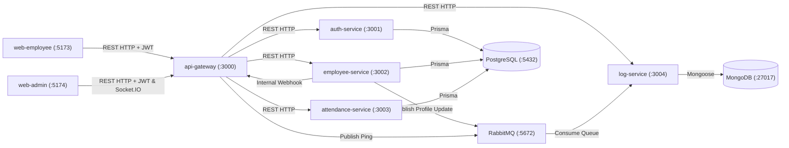

# Dexa WFH Attendance System — Microservices Monorepo

Microservices monorepo for the **Dexa Group WFH Attendance System**, built with **Turborepo**, **pnpm**, **NestJS 11**, **React 19 (Vite + Tailwind CSS)**, **PostgreSQL (Prisma)**, **RabbitMQ**, **MongoDB**, and **Socket.IO**.

## Architecture



## Monorepo Structure

```text
dexa-wfh/
├── apps/
│   ├── api-gateway/         # :3000 Public REST Gateway, JWT/Role Guards, Swagger (/docs), Socket.IO
│   ├── auth-service/        # :3001 JWT Login, token validation, and password service (PostgreSQL)
│   ├── employee-service/    # :3002 Employee self-profile, multipart photo upload, Admin HRD CRUD
│   ├── attendance-service/  # :3003 WFH check-in/out (Asia/Jakarta), paired summary, Admin monitoring
│   ├── log-service/         # :3004 RabbitMQ consumer + REST audit log service (MongoDB)
│   ├── web-employee/        # :5173 Employee React + Vite + Tailwind portal
│   └── web-admin/           # :5174 HRD Admin React + Vite + Tailwind + Socket.IO portal
├── packages/
│   ├── common/              # Shared DTOs, JWT/bcrypt helpers, Jakarta date helpers, avatar storage
│   ├── config/              # Environment variable loader and CORS/port validator
│   ├── database/            # Prisma schema, migrations, seed script, and NestJS DatabaseModule
│   ├── ui/                  # Shared React UI components (Button, Input, Card)
│   ├── tsconfig/            # Shared TypeScript configurations (base, nestjs, react)
│   └── eslint-config/       # Shared ESLint flat configuration
├── uploads/avatars/         # Persistent employee avatar uploads
├── docker-compose.yml       # Full stack orchestration (Postgres, MongoDB, RabbitMQ, all apps)
├── Dockerfile               # Multi-stage Node 22 + pnpm build (runs as non-root node user)
└── .github/workflows/ci.yml # GitHub Actions CI pipeline (lint -> typecheck -> test -> build)
```

## Default Seeded Accounts

Run `pnpm db:seed` after migrating PostgreSQL to populate default accounts and sample current-month attendance records:

| Role | Email | Password | Position |
| :--- | :--- | :--- | :--- |
| `ADMIN` | `admin@example.com` | `REDACTED_ADMIN_PASSWORD` | HRD Manager |
| `EMPLOYEE` | `budi.santoso@example.com` | `REDACTED_EMPLOYEE_PASSWORD` | Senior Software Engineer |
| `EMPLOYEE` | `siti.rahma@example.com` | `REDACTED_EMPLOYEE_PASSWORD` | Product Designer |

## Core API Gateway Endpoints (`http://localhost:3000`)

- **Auth (`/auth`):**
  - `POST /auth/login` — Login with `{ email, password }` and receive JWT `accessToken`
  - `GET /auth/validate` & `POST /auth/validate` — Validate JWT token
  - `GET /auth/me` — Get current authenticated profile
  - `PATCH /auth/password` — Change password (`{ currentPassword, newPassword }`)
- **Employee Self-Service (`/employees/me`):**
  - `GET /employees/me` — View logged-in employee profile
  - `PATCH /employees/me` — Update phone, photo (`multipart/form-data` or `photoUrl`), or password; automatically logs to MongoDB via RabbitMQ and emits Socket.IO `admin.notification`
  - `POST /employees/me/photo` — Upload avatar image (`jpg/jpeg/png/webp`, max 5MB)
  - `GET /uploads/avatars/:filename` — Public static avatar route
- **Admin HRD Employee CRUD (`/employees`, Role `ADMIN`):**
  - `GET /employees` — List employees (`search`, `role`, `page`, `limit`)
  - `GET /employees/:id` — Get employee details
  - `POST /employees` — Create employee (supports multipart photo upload or `photoUrl`)
  - `PATCH /employees/:id` / `PUT /employees/:id` — Update employee
  - `DELETE /employees/:id` — Delete employee (cascades attendance, prevents self-deletion)
- **WFH Attendance (`/attendances`, Timezone `Asia/Jakarta`):**
  - `POST /attendances/check-in` — Record `MASUK` (max 1x per day)
  - `POST /attendances/check-out` — Record `PULANG` (requires `MASUK` first, max 1x per day)
  - `POST /attendances` — Record `{ status: "MASUK" | "PULANG" }`
  - `GET /attendances/today` — Today's check-in/check-out status
  - `GET /attendances/me` — Employee paired attendance summary (`Masuk | Pulang`, default current month start to today, supports `from` & `to`)
  - `GET /attendances` — Admin HRD read-only attendance monitoring (`from`, `to`, `employeeId`, `search`)
- **Audit Logs & Health:**
  - `GET /logs` — Profile change & system logs from MongoDB (`ADMIN` only)
  - `GET /health` & `GET /health/all` — Service and aggregated microservice health

## Getting Started

```bash
cp .env.example .env
docker compose up -d postgres mongodb rabbitmq
pnpm install
pnpm db:migrate
pnpm db:seed
pnpm build
pnpm lint
pnpm typecheck
pnpm test
```
