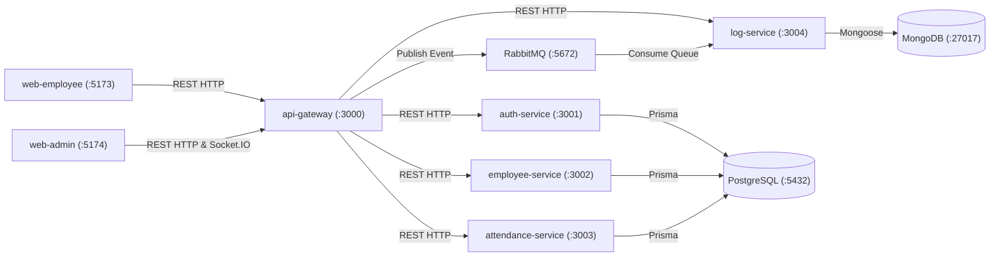

# Dexa WFH Attendance System — Monorepo Boilerplate

Microservices monorepo boilerplate (Stage 1) for the **Dexa Group WFH Attendance System**, built with **Turborepo**, **pnpm**, **NestJS 11**, **React 19 (Vite + Tailwind CSS)**, **PostgreSQL (Prisma)**, **RabbitMQ**, **MongoDB**, and **Socket.IO**.

## Architecture



## Monorepo Structure

```text
dexa-wfh/
├── apps/
│   ├── api-gateway/         # :3000 Public REST Gateway, Swagger (/docs), HTTP proxy, Socket.IO
│   ├── auth-service/        # :3001 Authentication microservice (NestJS REST + PostgreSQL)
│   ├── employee-service/    # :3002 Employee microservice (NestJS REST + PostgreSQL)
│   ├── attendance-service/  # :3003 WFH Attendance microservice (NestJS REST + PostgreSQL)
│   ├── log-service/         # :3004 RabbitMQ consumer + REST service persisting to MongoDB
│   ├── web-employee/        # :5173 Employee React + Vite + Tailwind portal
│   └── web-admin/           # :5174 HRD Admin React + Vite + Tailwind + Socket.IO portal
├── packages/
│   ├── common/              # Shared DTOs, queue/event constants, exception filter, health helper
│   ├── config/              # Environment variable loader and port validator
│   ├── database/            # Prisma schema, client, and NestJS DatabaseModule (PostgreSQL)
│   ├── ui/                  # Shared React UI components (Button, Input, Card)
│   ├── tsconfig/            # Shared TypeScript configurations (base, nestjs, react)
│   └── eslint-config/       # Shared ESLint flat configuration
├── docker-compose.yml       # Full stack orchestration (Postgres, MongoDB, RabbitMQ, all apps)
├── Dockerfile               # Multi-stage Node 22 + pnpm build
└── .github/workflows/ci.yml # GitHub Actions CI pipeline (lint -> typecheck -> test -> build)
```

## Service Ports

| Application / Service | Port | Description |
| :--- | :--- | :--- |
| `api-gateway` | `3000` | Public API Gateway, Swagger UI at `/docs`, Socket.IO server |
| `auth-service` | `3001` | Authentication REST microservice (`GET /health`) |
| `employee-service` | `3002` | Employee management REST microservice (`GET /health`) |
| `attendance-service` | `3003` | Attendance tracking REST microservice (`GET /health`) |
| `log-service` | `3004` | Audit log consumer (RabbitMQ -> MongoDB) & REST (`GET /health`, `GET /logs`) |
| `web-employee` | `5173` | Employee web application |
| `web-admin` | `5174` | HRD Admin web application with real-time Socket.IO toast notifications |
| `PostgreSQL` | `5432` | Primary relational database |
| `MongoDB` | `27017` | Audit & event log database |
| `RabbitMQ` | `5672` / `15672` | AMQP message broker & Management UI |

## Getting Started

### 1. Environment Setup

Copy `.env.example` to `.env`:

```bash
cp .env.example .env
```

### 2. Start Infrastructure (PostgreSQL, MongoDB, RabbitMQ)

```bash
docker compose up -d postgres mongodb rabbitmq
```

### 3. Install Dependencies & Build

```bash
pnpm install
pnpm build
```

### 4. Verify Lint, Typecheck, and Tests

```bash
pnpm lint
pnpm typecheck
pnpm test
```

### 5. Run Services & Verify Health / Event Flow

- Individual service health:
  - `GET http://localhost:3000/health`
  - `GET http://localhost:3001/health`
  - `GET http://localhost:3002/health`
  - `GET http://localhost:3003/health`
  - `GET http://localhost:3004/health`
- Aggregated microservice health via Gateway REST proxy:
  - `GET http://localhost:3000/health/all`
- Trigger sample event (`api-gateway` -> `RabbitMQ` -> `log-service` -> `MongoDB` + `Socket.IO`):
  - `POST http://localhost:3000/ping` with `{"message": "Hello from Gateway"}`
  - Inspect stored MongoDB logs via `GET http://localhost:3000/logs` or `GET http://localhost:3004/logs`
