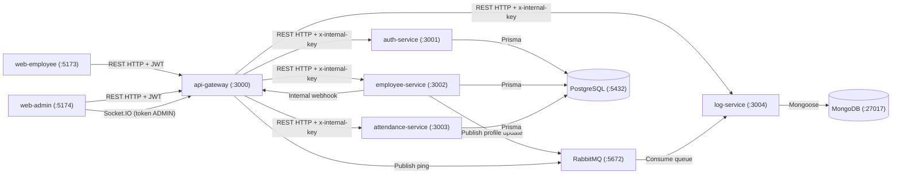

# Dexa WFH Attendance System: Microservices Monorepo

Sistem absensi Work From Home (WFH) Dexa Group: portal karyawan (absen masuk/pulang, profil, rekap), portal Admin HRD (CRUD karyawan, monitoring absensi read-only, notifikasi real-time), lima microservice NestJS, dan PostgreSQL, RabbitMQ, MongoDB sebagai pendukung.

Stack: **Turborepo**, **pnpm workspace**, **NestJS 11**, **React 19 (Vite + Tailwind CSS v4)**, **Prisma/PostgreSQL**, **RabbitMQ**, **MongoDB (Mongoose)**, **Socket.IO**.

## Arsitektur



Catatan alur notifikasi: setiap `POST /attendances/check-in` dan `/check-out` yang sukses di-proxy gateway, lalu gateway memancarkan event Socket.IO `admin.notification` (dengan `event: "attendance.recorded"` dan nama karyawan) ke dashboard Admin HRD. Perubahan profil karyawan mengalir lewat employee-service, RabbitMQ (audit log ke MongoDB), webhook internal ke gateway, lalu Socket.IO.

## Struktur Monorepo

```text
dexa-wfh/
├── apps/
│   ├── api-gateway/         # :3000 REST gateway, JWT/Role guard, proxy internal, Swagger (/docs), Socket.IO
│   ├── auth-service/        # :3001 login JWT, validasi token, ganti password (PostgreSQL)
│   ├── employee-service/    # :3002 profil karyawan, unggah foto multipart, CRUD Admin HRD
│   ├── attendance-service/  # :3003 absen masuk/pulang (Asia/Jakarta), rekap, monitoring admin
│   ├── log-service/         # :3004 konsumen RabbitMQ + REST audit log (MongoDB)
│   ├── web-employee/        # :5173 portal karyawan (React + Vite + Tailwind)
│   └── web-admin/           # :5174 portal Admin HRD (React + Vite + Tailwind + Socket.IO)
├── packages/
│   ├── common/              # DTO bersama, helper JWT/bcrypt, tanggal Jakarta, penyimpanan avatar, guard internal
│   ├── config/              # Pembaca environment dan validasi port/CORS
│   ├── database/            # Skema Prisma, migrasi, seed, DatabaseModule
│   ├── ui/                  # Komponen UI bersama (Button, Input, Card, Badge, Alert, Avatar, Modal, Spinner)
│   ├── tsconfig/            # Konfigurasi TypeScript bersama
│   └── eslint-config/       # Konfigurasi ESLint flat bersama
├── uploads/avatars/         # Penyimpanan avatar karyawan (volume Docker: uploads_data)
├── docker-compose.yml       # Orkestrasi seluruh stack + seed otomatis (service db-init)
├── Dockerfile               # Multi-stage Node 22 + pnpm (berjalan sebagai user non-root `node`)
└── .github/workflows/ci.yml # CI: lint, typecheck, test, build
```

## Prasyarat

- **Docker Compose v2** (cara termudah, tidak perlu Node lokal).
- Untuk mode pengembangan lokal: **Node.js >= 22**, **pnpm 10.28.0** (`corepack enable`), PostgreSQL, MongoDB, dan RabbitMQ yang dapat dijangkau.
- Port host yang harus bebas: `3000`, `3001`, `3002`, `3003`, `3004`, `5173`, `5174`, `5432`, `5672`, `15672`, `27017`.

## Menjalankan seluruh stack dengan Docker Compose

```bash
docker compose up --build -d      # build image, jalankan semua service + seed database
docker compose ps                 # semua service harus "healthy" / db-init "exited (0)"
docker compose logs -f api-gateway
docker compose down               # hentikan stack (tambahkan -v untuk menghapus volume data)
```

Semua service aplikasi (5 microservice, gateway, 2 frontend, dan `db-init`) memakai satu image bersama `dexa-wfh-app:local` yang berisi seluruh monorepo; setiap container hanya mengganti `working_dir` dan `command`, sehingga build hanya sekali, bukan delapan kali.

Urutan yang dijamin Compose: `postgres`/`mongodb`/`rabbitmq` healthy -> service `db-init` menjalankan `prisma migrate deploy` dan `db:seed` sampai selesai -> microservice healthy -> `api-gateway` healthy -> `web-employee` dan `web-admin`.

Setelah stack hidup:

- Portal karyawan: <http://localhost:5173>
- Portal Admin HRD: <http://localhost:5174>
- API Gateway: <http://localhost:3000> (Swagger UI: <http://localhost:3000/docs>)
- RabbitMQ management: <http://localhost:15672> (`guest` / `guest`)

`VITE_API_GATEWAY_URL` dibaca saat **build** image frontend. Nilai default di dalam kode adalah `http://localhost:3000`, jadi build standar sudah cocok untuk pemakaian lokal. Untuk alamat gateway lain, set variabel itu sebelum `docker compose build`.

### Akses dari perangkat lain di jaringan lokal (LAN)

`CORS_ALLOW_LAN` mengizinkan origin perangkat lokal tanpa mendaftarkan IP satu per satu. Saat aktif, gateway menerima origin yang hostname-nya `localhost`, `127.0.0.1`, `0.0.0.0`, `::1`, atau IPv4 privat (`10.x.x.x`, `172.16-31.x.x`, `192.168.x.x`), pada port dan skema apa pun (http/https). Origin publik seperti `https://evil.example` tetap ditolak. Origin yang lolos selalu **direfleksikan** (bukan wildcard `*`) karena request memakai kredensial.

- Default: `true` saat `NODE_ENV=development`, `false` saat `production`/`test`.
- Docker Compose menjalankan gateway dengan `NODE_ENV=production`, jadi `docker-compose.yml` menetapkan `CORS_ALLOW_LAN: "true"` secara eksplisit untuk stack lokal ini.
- Saat `false`, perilaku lama berlaku: hanya origin yang persis ada di `CORS_ORIGIN` yang diterima.
- Dari HP atau laptop lain, buka `http://<IP-LAN-host>:5173` atau `:5174`, misalnya `http://192.168.10.172:5173`. Jangan memakai `0.0.0.0` sebagai alamat navigasi di browser; Chrome modern memblokirnya. `0.0.0.0` hanya alamat bind di sisi server.
- Frontend Docker sudah bind `0.0.0.0` lewat `vite preview`, dan `pnpm dev` memakai `host: true`. Pastikan firewall host mengizinkan port `3000`, `5173`, dan `5174`.

Logika CORS yang sama dipakai HTTP gateway (`enableCors`) dan handshake Socket.IO, lewat satu helper `createCorsOriginValidator` di `packages/config`.

## Menjalankan mode pengembangan (pnpm)

```bash
cp .env.example .env              # opsional: semua variabel punya default untuk localhost
docker compose up -d postgres mongodb rabbitmq
pnpm install
pnpm db:migrate                   # prisma migrate deploy
pnpm db:seed                      # akun demo + riwayat absensi bulan berjalan
pnpm build                        # build semua paket/aplikasi (turbo)
pnpm lint && pnpm typecheck && pnpm test

# backend (setiap service berjalan dari hasil build)
pnpm --filter @dexa-wfh/auth-service start
pnpm --filter @dexa-wfh/employee-service start
pnpm --filter @dexa-wfh/attendance-service start
pnpm --filter @dexa-wfh/log-service start
pnpm --filter @dexa-wfh/api-gateway start

# frontend (Vite dev server, hot reload)
pnpm --filter @dexa-wfh/web-employee dev   # :5173
pnpm --filter @dexa-wfh/web-admin dev      # :5174
```

`pnpm dev` di root menjalankan `turbo run dev` (mode watch kompilasi backend + Vite untuk frontend) bila Anda ingin alur watch, bukan menjalankan service dari `dist`.

## Daftar Port

| Port | Komponen | Keterangan |
| :--- | :--- | :--- |
| `3000` | api-gateway | REST API publik, Socket.IO, Swagger `/docs` |
| `3001` | auth-service | Internal, dijaga `x-internal-key` |
| `3002` | employee-service | Internal, dijaga `x-internal-key` |
| `3003` | attendance-service | Internal, dijaga `x-internal-key` |
| `3004` | log-service | Internal, dijaga `x-internal-key` |
| `5173` | web-employee | Portal absensi karyawan |
| `5174` | web-admin | Portal monitoring Admin HRD |
| `5432` | PostgreSQL | Basis data utama (Prisma) |
| `5672` / `15672` | RabbitMQ | AMQP / management UI |
| `27017` | MongoDB | Audit log |

## Akun Seed

`pnpm db:seed` (atau service `db-init` di Compose) mengisi akun berikut beserta riwayat absensi contoh bulan berjalan:

| Peran | Email | Password | Posisi |
| :--- | :--- | :--- | :--- |
| `ADMIN` | `admin@example.com` | `REDACTED_ADMIN_PASSWORD` | HRD Manager |
| `EMPLOYEE` | `budi.santoso@example.com` | `REDACTED_EMPLOYEE_PASSWORD` | Senior Software Engineer |
| `EMPLOYEE` | `siti.rahma@example.com` | `REDACTED_EMPLOYEE_PASSWORD` | Product Designer |

Kredensial ini hanya untuk pengembangan/demo. Ganti `JWT_SECRET`, `INTERNAL_API_KEY`, dan password akun sebelum dipakai di lingkungan nyata.

## Endpoint API Gateway (`http://localhost:3000`)

- **Auth (`/auth`):**
  - `POST /auth/login` - `{ email, password }` -> JWT `accessToken`
  - `GET /auth/validate`, `POST /auth/validate` - validasi token
  - `GET /auth/me` - profil pemilik token
  - `PATCH /auth/password` - ganti password (`currentPassword` wajib)
- **Karyawan (`/employees/me`):**
  - `GET /employees/me` - profil karyawan yang login
  - `PATCH /employees/me` - ubah nomor HP, foto (`multipart/form-data` atau `photoUrl`), dan/atau password milik sendiri
  - `POST /employees/me/photo` - unggah avatar (`jpg/jpeg/png/webp`, maks 5MB)
  - `GET /uploads/avatars/:filename` - akses publik avatar
- **CRUD Karyawan (`/employees`, peran `ADMIN`):**
  - `GET /employees` - daftar karyawan (`search`, `role`, `page`, `limit`)
  - `GET /employees/:id` - detail karyawan
  - `POST /employees` - tambah karyawan (mendukung unggah foto)
  - `PATCH /employees/:id`, `PUT /employees/:id` - ubah data karyawan
  - `DELETE /employees/:id` - hapus karyawan (absensi ikut terhapus, akun sendiri ditolak)
- **Absensi (`/attendances`, zona waktu `Asia/Jakarta`):**
  - `POST /attendances/check-in` - catat `MASUK` (maksimal 1x per hari)
  - `POST /attendances/check-out` - catat `PULANG` (wajib setelah `MASUK`, maksimal 1x per hari)
  - `POST /attendances` - catat `{ status: "MASUK" | "PULANG" }`
  - `GET /attendances/today` - status absen hari ini
  - `GET /attendances/me` - rekap pasangan `Masuk | Pulang` (default awal bulan berjalan s/d hari ini, filter `from` dan `to`)
  - `GET /attendances` - monitoring read-only untuk `ADMIN` (`from`, `to`, `employeeId`, `search`)
- **Log & kesehatan:**
  - `GET /logs` - audit log dari MongoDB (`ADMIN`)
  - `GET /health`, `GET /health/all` - status gateway dan seluruh microservice
- **Socket.IO:** koneksi ke `http://localhost:3000` dengan `auth.token` = JWT peran `ADMIN`; event keluar `admin.notification`.

## Catatan Keamanan

- **Autentikasi berlapis:** seluruh endpoint non-publik memerlukan JWT; endpoint berperan `ADMIN` dijaga `RolesGuard`. Karyawan tidak dapat mengakses daftar karyawan, CRUD, monitoring, atau log (HTTP 403).
- **Kunci internal antar-layanan:** gateway selalu mengirim header `x-internal-key` saat memanggil `auth-service`, `employee-service`, `attendance-service`, dan `log-service`. Akses langsung ke port internal tanpa kunci ditolak `403 Forbidden`.
- **Tidak ada IDOR pada perubahan akun:** `PATCH /employees/me` dan ganti password memakai identitas dari token, `userId` di body diabaikan, dan password sendiri hanya bisa diubah setelah `currentPassword` terverifikasi.
- **Handshake Socket.IO terautentikasi:** `notifications.gateway.ts` memverifikasi JWT pada handshake; token tidak ada, kedaluwarsa, atau bukan peran `ADMIN` langsung diputus (`Unauthorized`), sehingga kanal real-time dan broadcast `ping` tidak bisa dipakai tanpa login admin.
- **Validasi unggahan gambar:** MIME, ekstensi, dan *magic bytes* (`PNG`, `JPEG`, `WEBP`) diperiksa; ukuran dibatasi 5MB; nama file diacak dan disimpan di `uploads/avatars` (volume terpisah pada Compose).
- **Rahasia lingkungan:** `JWT_SECRET` dan `INTERNAL_API_KEY` default hanya untuk pengembangan; wajib diganti lewat `.env` untuk produksi. File `.env` di-ignore Git.
- **Operasi destruktif dibatasi:** admin tidak dapat menghapus akunnya sendiri; penghapusan karyawan menghapus riwayat absensinya secara cascade dan memerlukan konfirmasi di UI.
